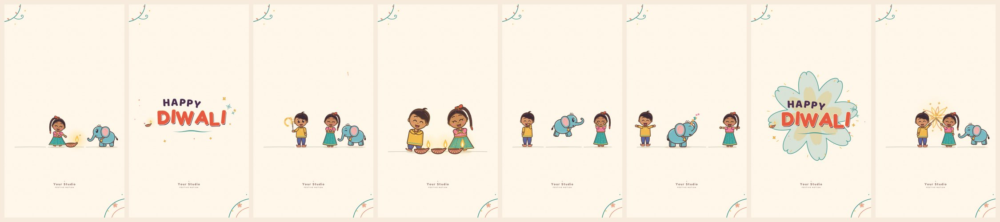

# Diwali Spark Parade

An original 21.92-second vertical Diwali greeting written in HTML, CSS and JavaScript. Two children and a baby elephant light diyas, draw loops with sparklers, chase a spinning chakri and skip in a small parade, with short "HAPPY DIWALI" title cards in between. The soundtrack is composed for this piece and synthesised live with Web Audio.



It follows `diwali_video_style_original_variant.json`. It keeps the reference's broad feel: a joyful, fast-cut, minimal 2D festival cartoon in 9:16 with lots of cream space. The characters, palette, typography, choreography, transitions and music are all new. Nothing was traced, sampled or transcribed.

| | |
|---|---|
| Output | 720 × 1280 (9:16), 30 fps, 21.92 s seamless loop (658 frames) |
| Engine | HTML Canvas 2D drawing modular SVG cut-out rigs, `requestAnimationFrame`, no libraries |
| Audio | Original score, about 142 BPM in 4/4 (13 bars fill the loop exactly), plus synced sound effects, all synthesised |
| Export | WebM (VP9 + Opus) recorded in the browser, an FFmpeg one-liner for MP4, and an optional frame-exact offline renderer |

## Quick start

- **Double-click `index.html`.** It works from `file://`: the SVG rigs and fonts are also inlined in `assets/offline-bundle.js`.
- **Or serve the folder** (recommended while editing the SVGs, which are then fetched live):
  `python3 -m http.server 8000` and open <http://localhost:8000/>.

The picture starts playing silently. Tap **Tap for sound** or the speaker button to start the music, because browsers only allow audio after a click or tap.

| Control | What it does |
|---|---|
| Play / Pause, Restart, scrub bar | Transport. The scrub bar shows the current shot name. |
| Speaker button, Volume | Mute/unmute and level. Music and picture share one clock. |
| Preview speed | 0.5×, 0.75×, 1×, 1.5×. The soundtrack is re-rendered at the new tempo so its pitch stays the same. |
| Reduced motion | Smaller bounces, fewer particles, fades instead of pops, hard cuts instead of wipes. It is on by default when the OS asks for reduced motion. |
| Sound effects, Paper grain | Toggle the SFX bus or the barely visible paper texture. |
| Customise | Title lines, studio credit, palette presets (Cream & teal, Marigold morning, Lantern night), seven colour pickers, loop length. These settings are saved in this browser. |
| Record WebM | Records one loop in real time. See [Export](#export). |
| Keys | `Space` play/pause, `←`/`→` step one frame (`Shift` = 1 s), `R` restart, `M` sound |

URL options: `?t=12.5` start time, `?paused`, `?nosound` (skip pre-composing audio), `?reduced` / `?reduced=0`, `?reset` (palette back to default), `?sheet` (developer rig sheet showing every character and pose).

## What is shared with the reference and what is new

| Kept (mood, pacing, format) | Redesigned (look, choreography, sound) |
|---|---|
| 9:16 short loop, warm clean background, lots of empty space | New cream, teal, coral, saffron and plum palette |
| Cute squash-and-stretch 2D cartoon, children enjoying Diwali | New children: a boy with a side-swept wavy fringe, cowlick, freckles, mustard kurta, indigo dhoti trousers and coral juttis; a girl with a high braided ponytail, asymmetric bow, bindi, rose tunic, turquoise skirt and gold anklets |
| Short greeting cards between quick cuts | A baby elephant instead of a peacock: one oversized peach-lined ear, curled trunk, single gold bell |
| Rhythmic fast cuts with sparkle accents | An offset two-line title: an arched plum **HAPPY** over a big coral **DIWALI** with a cream rim and plum shadow on a lifted baseline, a diya at left, turquoise sparkle-flowers at right and a brush underline |
| Upbeat Indian-festival energy | Small turquoise/coral folk flourishes in the top-left and bottom-right corners instead of solid corner blobs |
| | Diyas, sparklers and a ground chakri as the main action, with only two tiny rocket accents |
| | A new 24-shot sequence, new gags, wavy sparkle wipes, a flower-star reveal, a blooming title and a star-to-flame loop return |
| | An original soundtrack: a rising three-note mallet call answered by a falling bamboo-flute line |

## The 24-part sequence

All times are in timeline seconds. **W** marks a wavy sparkle-match wipe; every other change is a hard cut or the shot's own reveal.

| # | Time (s) | Shot | What happens |
|---|---|---|---|
| 1 | 0.00–0.65 | diyaWelcome | The girl kneels at a diya. The opening gold star on the wick sparks the flame, and the elephant peeks in. |
| 2 | 0.65–1.75 | greetingTitle | The lockup bounces up letter by letter. The diya, doodles and underline pop in after. |
| 3 | 1.75–2.75 | sparklerPlay | The boy draws a glowing circle with a sparkler, the girl smiles, the elephant bobs on the beat. Rocket accent #1 appears far off. |
| 4 | 2.75–3.65 | spinnerStarts **W** | The chakri winds up. Both kids do a surprised hop, then cheer. |
| 5 | 3.65–4.30 | greetingTitle | A diagonal pop with a different confetti layout. |
| 6 | 4.30–5.35 | elephantDance | The elephant bounces on every beat (dust puffs on landing) and waves its curled trunk. The kids sway and wave. |
| 7 | 5.35–5.85 | starburstTitle | A hand-drawn flower-star wipe blooms open to reveal the title. |
| 8 | 5.85–7.05 | sparklerTrail | The girl paints a soft gold loop. Once it fades, the boy hops through where it was. |
| 9 | 7.05–7.75 | diyaCloseup **W** | Close-up: three diyas light in a row and the kids' faces glow. |
| 10 | 7.75–8.55 | greetingTitle | A slow staggered letter entrance with a waved underline. |
| 11 | 8.55–9.70 | spinnerDance | The chakri throws rainbow speed rings and gold dashes while the kids shuffle side to side. |
| 12 | 9.70–10.65 | comedyHop **W** | A harmless sparkle startles the elephant: a hop, a squash-bounce landing, then giggles. |
| 13 | 10.65–11.75 | greetingTitle | Flower-shaped fireworks bloom behind the title. |
| 14 | 11.75–12.85 | diyaAndSparkle | A tiny breeze bends the flame and the boy cups his hand around it. The girl waves a figure-eight sparkler in the background. |
| 15 | 12.85–13.65 | elephantTrunk **W** | The elephant raises its trunk and puffs out star confetti while the kids cheer. |
| 16 | 13.65–14.35 | greetingTitle | A gentle tilt spring with soft drifting dots. |
| 17 | 14.35–15.55 | miniParade | A skipping parade whose steps land on the beat, with sparkles drifting above. Rocket accent #2 appears. |
| 18 | 15.55–16.50 | spinnerFinale **W** | The chakri skitters through two colourful figure-eight loops, slows and settles in a puff. |
| 19 | 16.50–17.25 | flowerStarTitle | The greeting emerges from a blooming turquoise-and-gold starburst. |
| 20 | 17.25–18.45 | friendlyGiggle | The boy does one paper-turn pirouette, gets dizzy (spiral eyes, orbiting stars) and giggles. The girl claps in sync with the clap sounds. |
| 21 | 18.45–19.00 | greetingTitle | A quick word pop with a twinkling diya. |
| 22 | 19.00–20.05 | sparkleBouquet | The kids cross two sparklers and a flower of light blooms between them. The elephant dances. |
| 23 | 20.05–20.85 | finalTitle | The title settles and holds long enough to read. |
| 24 | 20.85–21.92 | loopReturn | The title fades, its gold star glides onto the opening diya's wick, and an iris opens on frame 0. The loop has no black or white frame: the last frame is pixel-identical to the first. |

## Artwork: editable SVG rigs

Every character and prop is hand-authored vector art in `assets/`. Each file opens as an ordinary SVG and is also the runtime source of truth: `main.js` parses it into an animatable rig.

| File | Rigs |
|---|---|
| `assets/kids-original.svg` | `boy`, `girl` |
| `assets/baby-elephant.svg` | `elephant` |
| `assets/diya.svg` | `diya` (separate `flame` part) |
| `assets/sparkler-and-chakri.svg` | `sparkler`, `chakri` |

The SVGs use a few `data-` attributes to describe the rig:

- `data-rig="name"` marks one character. The origin (0,0) is the ground point between the feet, and the group's own `transform` is only there to lay out the file for viewing.
- `data-part="name"` marks an animatable part. Nested parts inherit their parent's motion.
- `data-pivot="x y"` sets the rotation and scale pivot. `data-bend="ax ay bx by"` adds a bend axis for the rubber-hose deformer (arms, braid, trunk, tail and flame use it).
- `data-attach="tip"` makes a child ride the bent tip of its parent (hands on arms, the tassel on the braid).
- `data-switch` / `data-state` hold alternative states (eyes: open, wide, happy, closed, dizzy; mouths). `data-anchor` marks an invisible locator, such as the sparkler grips and the trunk tip.
- Mirrored parts reuse the same geometry with `transform="scale(-1 1)"`. The loader bakes all transforms, so files edited in Inkscape or Illustrator still work.
- Fills that exactly match a palette token (outline plum-brown, gold, turquoise, mustard and so on) are re-tinted live when the palette changes.

After editing an SVG, run `node tools/build-offline-bundle.mjs` so the `file://` fallback matches. `--check` reports whether the bundle is stale.

## How the animation works

- **Pure function of time.** `renderFrame(ctx, t, scale)` draws timeline time `t` with no state carried between frames. Preview, scrubbing, reduced motion and export therefore always agree.
- **Poses** are small per-part transforms (rotate, translate, squash/stretch, bend) layered from helpers: breathing and blinking, hops with anticipation and landing squash, beat-locked bounces and skips, crouches, waves and cheers.
- **IK**: the reach solver uses the bend deformer, so arms curve naturally with the elbow bulging down and out. Sparklers are aimed by their tips: every circle, loop and figure-eight is drawn by a real hand-held sparkler held away from the face and body.
- **Particles** come from `drawParticles`, a seeded, stateless emitter: particle *i* is born at `t0 + i/rate` from its own RNG. Sparkler crackle, chakri dashes, confetti and drifting glints therefore look identical every time you scrub to the same frame.
- **30 fps everywhere.** The preview quantises time to 30 fps (even on 120 Hz screens). When sound is on, the picture follows the audio clock, so A/V sync cannot drift.
- **Transitions**: about 75% hard cuts and about 25% wavy sparkle-match wipes, plus the flower-star reveal, the bloom title and the iris loop return.

The functions named in the spec's architecture exist under the same names: `renderFrame`, `drawBackground`, `drawFolkFlourishes`, `drawOriginalKids`, `drawBabyElephant`, `drawDiyasAndSpinner`, `drawSparklers`, `drawNewGreetingTitle`, `drawParticles`, `drawFooter`, `scheduleOriginalMusicAndSFX`, `recordVideo`.

## The soundtrack

The score was written for this piece in D major pentatonic. The tempo is 52 beats ÷ 21.92 s ≈ 142.3 BPM, so 13 bars of 4/4 fill the loop exactly and the downbeat always comes back on the opening diya ignition.

| Bars | Seconds | Arrangement |
|---|---|---|
| 1–5 | 0–8.4 | Hook: the mallet plays a rising A–B–D call and the bamboo-flute synth answers with a falling A–F♯–E–D–B–A line. Dholak-style "dhum/ta/na" groove, claps on 2 and 4, shaker eighths, thumb-piano plucks. Bass from bar 3, bells from bar 5. |
| 6–8 | 8.4–13.5 | A softer phrase: held flute notes over mallet arpeggios (G, Em→A, Bm→A), lighter percussion, small fills under the elephant hop and the diya scene. |
| 9–11 | 13.5–18.5 | The hook returns with sixteenth-note shaker and a skipping bell run for the parade. |
| 12–13 | 18.5–21.9 | A climactic chime flourish, a tonic landing and a dholak turnaround roll back to the loop downbeat. |

Instruments are synthesised: sine/triangle mallet with a 4× overtone and a soft strike, triangle flute with breath noise and delayed vibrato, inharmonic bells, a pitch-bent "dhum" and slap "ta", filtered-noise claps and shaker, and a round low-passed bass.

There are over 50 sound-effect cues placed on the visual events: a glassy shimmer for each diya ignition, sparkler sizzle with glittering ticks, a chakri whirr that winds up and down, cartoon boops with a bell jingle for elephant hops, marimba-and-chime title pops, soft footsteps, the breeze, a trunk toot, a dizzy boing and claps.

Mixing: music and SFX are rendered offline with `OfflineAudioContext`, so the result is deterministic. The reverb tail is wrapped back onto the start, which makes the loop seamless; this replaces the spec's 150 ms crossfade. Music is peak-normalised to −6 dBFS and SFX to −11 dBFS (−5 dB relative), the top end is filtered, and there are no samples or recordings of any kind.

## Export

**In the browser (WebM).** The **Record WebM** button records one loop in real time, which takes about 22 seconds:

- It draws a dedicated 720×1280 canvas and pushes exactly one frame per 1/30 s of the audio clock (`captureStream(0)` + `requestFrame()`, falling back to `captureStream(30)`).
- It routes the soundtrack through `MediaStreamAudioDestinationNode` into `MediaRecorder` (VP9/VP8 + Opus, about 8 Mbps).
- It writes a Duration into the WebM header so players can seek.

Keep the tab visible while it records, because browsers throttle hidden tabs. Convert the result to MP4 with:

```sh
ffmpeg -i diwali-spark-parade.webm -c:v libx264 -pix_fmt yuv420p -r 30 -c:a aac -b:a 192k -movflags +faststart diwali-spark-parade.mp4
```

**Frame-exact offline render (optional).** This renders every frame from the timeline rather than in real time, so it works the same on any machine and at any speed. It needs Node 18+, Playwright with Chromium (`npm i -D playwright && npx playwright install chromium`) and FFmpeg:

```sh
node tools/render-video.mjs                        # → diwali-spark-parade.mp4 (H.264 + AAC, 658 frames)
node tools/render-video.mjs --out loop.webm        # VP9 + Opus
node tools/render-video.mjs --scale 1.5            # 1080×1920
node tools/render-video.mjs --from 4.3 --to 9.7    # a section
node tools/render-video.mjs --frames out/          # PNG sequence
node tools/render-video.mjs --reduced-motion --no-audio
```

## Accessibility

- The **Reduced motion** option follows the OS setting by default, and the animation does not autoplay when the OS asks for reduced motion.
- Controls are at least 44 px, focus rings are visible, and everything works from the keyboard.
- The mute control uses `aria-pressed`, and status messages are announced with `aria-live`.
- The greeting appears as a text caption under the stage, and the canvas has a descriptive `aria-label`. Both update when you change the title.
- The page chrome has light and dark themes. The animation keeps its own palette, or uses the Lantern night preset.

## Files

```
index.html                    page shell, controls and caption
styles.css                    responsive layout (object-fit: contain stage), light/dark themes
main.js                       rig loader and renderer, poses, effects, title, 24 shots, soundtrack, player, exporter
assets/kids-original.svg      boy and girl rigs
assets/baby-elephant.svg      elephant rig
assets/diya.svg               clay diya + flame
assets/sparkler-and-chakri.svg
assets/offline-bundle.js      generated: SVGs + fonts inlined for file://
assets/fonts/                 Fredoka and Baloo 2 (woff2, SIL OFL 1.1)
tools/build-offline-bundle.mjs
tools/render-video.mjs        optional deterministic MP4/WebM/PNG renderer
docs/preview.jpg              README image
```

## Browser support

The page works in current Chrome, Edge, Firefox and Safari. In-browser WebM recording needs `MediaRecorder` with WebM support (Chrome, Edge, Firefox). Where it is missing, the page says so, and `tools/render-video.mjs` makes the video instead.

## Credits and licences

All illustrations, animation, code, music and sound design are original to this project. The title fonts are [Fredoka](https://github.com/hafontia/Fredoka-One) and [Baloo 2](https://github.com/EkType/Baloo2), both under the SIL Open Font License 1.1 (licence texts in `assets/fonts/`). The studio credit at the bottom is a placeholder ("Your Studio · Festive Motion") that you can change or turn off under **Customise**.
